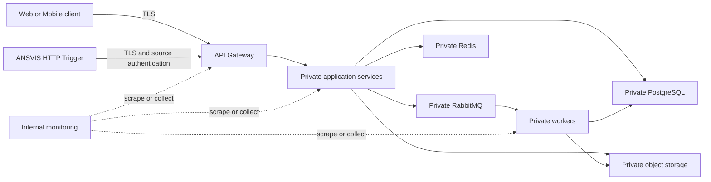

# Deployment architecture and capacity baseline

## Status and publication boundary

This is the numeric implementation baseline for Issue #96, dated 2026-07-30. It is a pilot and
initial-production planning input, not production provisioning, a hardware purchase order, or a
service-level guarantee. Activation still requires measured evidence from #95, ANSVIS/GPU evidence
from #30, backup and recovery evidence from #27/#55/#34, security review, and an approved change
record.

The document is classified Medium. It intentionally contains no address, hostname, credential,
account/provider identifier, school/camera location, secret-manager mapping, personal data,
biometric data, evidence locator, or production endpoint.

## Source figures and pass bars

The authoritative sanitized source is
[`docs/nfr-baseline.md`](../nfr-baseline.md). Values below are copied with their status, date, and
guardrails rather than silently re-derived.

| Input | Baseline |
|---|---:|
| Supplied measurement, 2026-07-16 | 2 cameras x 2 tasks; 2,000 JSON events in 2 hours |
| Derived average for 34 cameras x 7 pipelines | 16.53 events/second |
| Camera-task planning maximum | 238 |
| Theoretical `Every Detection` ceiling at 10 FPS | 2,380 events/second; blocked without explicit approval |
| Sustained load profile | 50 events/second for 60 minutes |
| Burst load profile | 200 events/second for 5 minutes |
| Soak profile | At least 35 events/second for 8 hours |
| Durable ingestion ACK | p95 <= 300 ms; p99 <= 1 second |
| Oversized/invalid rejection | p95 <= 200 ms before business processing |
| Post-burst backlog | Drain <= 15 minutes with no accepted-event loss |
| Continuous-row planning volume | Approximately 1.428 million rows/day |
| Media sizing illustration | Approximately 286 GB/day if every event carried 200 KiB |
| Core RPO/RTO | <= 15 minutes / <= 4 hours |
| Evidence RPO/RTO | <= 24 hours / <= 8 hours |

The 16.53 events/second figure is an extrapolation, not a forecast. Event frequency, ROI, schedule,
model, retry, crowd behavior, media attachment ratio, ANSVIS license, GPU/VRAM, decode load, and frame
age/drop remain measured inputs. The 2,380 events/second configuration is never an ordinary capacity
target.

## Deployment decision and trust boundaries

Single-host deployment is permitted only for local development with fake or sanitized data.
Staging, pilot, and production use split stateful/application boundaries. This avoids presenting a
developer Compose host as an availability, isolation, or recovery design.



Mandatory boundaries:

- the gateway is the only public application entry point and terminates approved TLS;
- ANSVIS uses the approved authenticated gateway ingestion route, never a direct database, broker,
  object-store, or business-service connection;
- application services, workers, PostgreSQL, Redis, RabbitMQ, object storage, and monitoring use
  private network segments and are not exposed directly to the Internet;
- `/metrics`, health detail, broker management, database, cache, and object-store administration are
  internal-only;
- evidence access is authorized by the owning API and uses a short-lived grant; bucket/object
  locations are not returned as permanent public identifiers;
- service-to-service identity, least privilege, private DNS, firewall rules, and secret injection
  are deployment controls; values do not belong in this document or Compose YAML.

## Reference node and storage baseline

The following is the starting capacity envelope for benchmark and parity work. CPU and memory are
allocations, not evidence of achieved throughput.

| Component boundary | Count | CPU each | RAM each | Persistent/ephemeral storage | Minimum sustained storage target |
|---|---:|---:|---:|---:|---:|
| Application/worker nodes | 2 | 8 vCPU | 16 GiB | 100 GB SSD ephemeral each | 500 IOPS each |
| PostgreSQL primary and recovery standby | 2 | 8 vCPU | 32 GiB | 1 TB NVMe each | 3,000 IOPS and 150 MiB/s each |
| RabbitMQ quorum nodes | 3 | 4 vCPU | 8 GiB | 200 GB SSD each | 1,500 IOPS each |
| Redis primary and replica | 2 | 2 vCPU | 4 GiB | 20 GB SSD each | 500 IOPS each |
| Private object-storage capacity boundary | Provider/implementation dependent | 8 vCPU equivalent | 32 GiB equivalent | 4 TB usable initial floor | 1,000 IOPS and 250 MiB/s |
| Monitoring/logging node | 1 for pilot | 4 vCPU | 16 GiB | 500 GB SSD | 1,000 IOPS |

The object-storage floor does not approve storing media for every event. At the 286 GB/day
illustration, 4 TB would hold less than 15 days before overhead and safety headroom. Pilot activation
therefore requires the measured evidence attachment ratio, average object size, lifecycle outcome,
replication/backup overhead, and retention mix to show at least 30 days until the 70% capacity alert.
If it does not, reduce evidence generation under approved business rules or increase private
capacity before activation.

PostgreSQL standby, backup, and object versioning are separate controls. A standby is not a backup,
and this table does not claim the RPO/RTO until #34 demonstrates restoration.

### Application process requests and hard limits

The scheduler or Compose deployment profile must set both a request/reservation and a hard limit.
Stateless processes use stdout/stderr logging and no persistent business data. Budget 2 GB ephemeral
disk and 100 burst IOPS per process unless a measured workload requires more.

| Runtime | Replicas | CPU request each | CPU limit each | RAM request each | RAM limit each |
|---|---:|---:|---:|---:|---:|
| API Gateway | 2 | 0.50 | 1.00 | 512 MiB | 1 GiB |
| Identity Service | 1 | 0.25 | 0.50 | 256 MiB | 512 MiB |
| School Service | 1 | 0.25 | 0.50 | 256 MiB | 512 MiB |
| Consent Service | 2 | 0.25 | 0.50 | 256 MiB | 512 MiB |
| Camera Registry Service | 1 | 0.25 | 0.50 | 256 MiB | 512 MiB |
| ANSVIS Adapter | 2 | 0.50 | 1.00 | 512 MiB | 1 GiB |
| Attendance Service | 2 | 0.25 | 0.50 | 256 MiB | 512 MiB |
| Timekeeping Service | 2 | 0.25 | 0.50 | 256 MiB | 512 MiB |
| Audit Log Service | 2 | 0.50 | 1.00 | 512 MiB | 1 GiB |
| Evidence Service | 2 | 0.50 | 1.00 | 512 MiB | 1 GiB |
| Notification Service | 1 | 0.25 | 0.50 | 256 MiB | 512 MiB |
| Report Service | 1 | 0.50 | 1.00 | 512 MiB | 1 GiB |
| Event outbox worker | 2 | 0.50 | 1.00 | 512 MiB | 1 GiB |

Limits are not autoscaling evidence. #95 records CPU throttling, memory peak/OOM, queue age, database
wait, event latency, and storage utilization per profile. Add replicas only when the database and
downstream budgets remain valid.

## PostgreSQL connection budget

The baseline pins `max_connections=100`. A read-only MCP observation on 2026-07-30 confirmed the
native development instance also reports 100; that observation is not a production configuration
change.

Every SQLAlchemy runtime must set `pool_size`, `max_overflow`, `pool_timeout=2` seconds, and
`pool_pre_ping=true` explicitly. Defaults such as `5 + 10` are forbidden because replica
multiplication can exhaust the global budget. Migration and one-shot test engines use `NullPool`.

| Database client | Replicas | `pool_size + max_overflow` each | Maximum connections |
|---|---:|---:|---:|
| Identity Service | 1 | 2 + 1 | 3 |
| School Service | 1 | 2 + 1 | 3 |
| Consent Service | 2 | 2 + 1 | 6 |
| Camera Registry Service | 1 | 2 + 1 | 3 |
| ANSVIS Adapter event store | 2 | 3 + 2 | 10 |
| ANSVIS Adapter consent read store | 2 | 1 + 0 | 2 |
| Attendance Service | 2 | 2 + 1 | 6 |
| Timekeeping Service | 2 | 2 + 1 | 6 |
| Audit Log Service | 2 | 2 + 1 | 6 |
| Evidence Service | 2 | 2 + 1 | 6 |
| Notification Service | 1 | 2 + 1 | 3 |
| Report Service | 1 | 3 + 1 | 4 |
| Event outbox worker event store | 2 | 2 + 1 | 6 |
| Event outbox worker audit store | 2 | 1 + 0 | 2 |
| **Application maximum** |  |  | **66** |

The remaining 34 connections are reserved:

| Reserve | Connections |
|---|---:|
| Migration/operator window | 4 |
| Monitoring and backup tooling | 5 |
| PostgreSQL superuser/system/recovery reserve | 10 |
| Unallocated rollout and approved future-service headroom | 15 |
| **Total with application maximum** | **100** |

Only one service rolls at a time, and overlap must fit the 15-connection headroom. A new service,
worker, replica, or second database pool requires an updated table before activation.

The ingestion allocation has 10 event-store connections across two replicas. Its preliminary
throughput equation is:

```text
10 concurrent connections / 0.050 seconds average transaction hold time
= 200 transactions/second
```

This is an assumption and a pass bar for #95, not proof. If transaction hold time exceeds 50 ms or
pool utilization exceeds 70%, first inspect query/index/lock behavior and queue backpressure. Do not
raise pool sizes independently. At 70% utilization alert Warning; at 85% alert Critical. Connection
wait, timeout, transaction duration, lock wait, error rate, and PostgreSQL saturation must be
reported together.

The event outbox worker now enforces a four-connection per-process maximum: event store `2 + 1` and
audit store `1 + 0`. Two replicas therefore consume at most eight connections.

## Staging parity and scale

Issue #41 must use the same services, versions, flags, trust boundaries, rate limits, queue policy,
and observability controls as this baseline. Staging resources are at least one quarter of the
reference resource baseline; replica counts may reduce to one only when the accepted difference,
owner, and benchmark impact are recorded. Images are promoted by digest without rebuild.

The 200 events/second burst profile still runs at full event rate in staging. Reducing hardware is
not permission to reduce the contract load; it is expected to expose the capacity knee.

## Split and growth triggers

Local single-host Compose must never be promoted as staging or production. For the split reference
topology:

- split Redis and RabbitMQ onto separate boundaries if either exceeds 60% CPU or 70% memory for
  15 minutes, or if broker disk/queue alerts occur under a non-stress profile;
- add application capacity when CPU exceeds 60% for 15 minutes or an SLO is missed while downstream
  and database utilization remain below 70%;
- review PgBouncer or equivalent controlled pooling before raising PostgreSQL `max_connections`
  when approved demand would exceed 80 connections;
- trigger event-table monthly RANGE partitioning before production when #95 measures sustained
  ingestion above 30 events/second or projects more than 50 million rows before go-live;
- expand or reduce object generation before forecast storage reaches 70% within 30 days; alert at
  70%, High at 85%, and Critical at 95%;
- split monitoring from any shared pilot host before production or when telemetry competes with a
  business SLO;
- block the `Every Detection` 2,380 events/second ceiling unless a separate approved benchmark,
  storage/privacy impact review, and change record all pass.

## Compose enforcement

The root Compose file remains a local infrastructure profile with fake/sanitized data only. Each
declared service must have:

- a digest-pinned image;
- an explicit non-root `user`;
- `no-new-privileges`;
- explicit CPU and memory hard limits;
- loopback-only published ports;
- the exact private network and workspace-local bind mount;
- a healthcheck.

Current local hard limits are:

| Service | User | CPU limit | RAM limit |
|---|---|---:|---:|
| `postgres-test` | `postgres` | 1.0 | 1 GiB |
| `redis` | `redis` | 0.5 | 512 MiB |
| `rabbitmq` | `rabbitmq` | 1.0 | 1 GiB |
| `minio` | numeric non-root UID/GID | 1.0 | 1 GiB |

`scripts/check_compose_safety.py` rejects missing/zero CPU, memory below 64 MiB, a missing or root
user, unsafe networks/ports/mounts, unpinned images, privilege, and missing healthchecks. When an
application container is added to Compose, it is subject to the same checks and the expected-service
allowlist must be reviewed explicitly.

## Backup, recovery, monitoring, and rollback dependencies

- #55 owns encryption and numeric RPO/RTO requirements.
- #27 owns executable backup/restore steps and secret references.
- #34 must prove restoration with sanitized, non-production data.
- #35 owns queue, retry, backpressure, and DLQ thresholds.
- #136 owns bounded metric names and label policy.
- #30 owns ANSVIS license, task, GPU/CPU, and camera-processing capacity.
- #95 owns measured pass/fail evidence and revisions to this baseline.

Rollback for this Issue is code/config rollback only: revert the worker pool configuration, Compose
limits, checker, and document as one reviewed change. Do not silently disable resource limits,
increase database connections, expose an internal service, reset local runtime data, or alter
production infrastructure as a rollback shortcut.

## Required evidence before activation

Record, using only synthetic or aggregate identifiers:

1. exact image/config/contract versions and deployment profile;
2. process and replica counts, CPU/RAM/storage allocation, and connection-budget reconciliation;
3. smoke, sustained, burst, soak, and recovery results from #95;
4. p50/p95/p99 latency, error, pool wait/utilization, queue depth/age/drain, CPU/RAM/IOPS, and storage
   growth;
5. restore timing and integrity evidence from #34;
6. ANSVIS license/GPU/task evidence from #30;
7. Compose-safety, quality, secret, and sanitization results;
8. approved deltas, owners, rollback steps, and the next review date.
